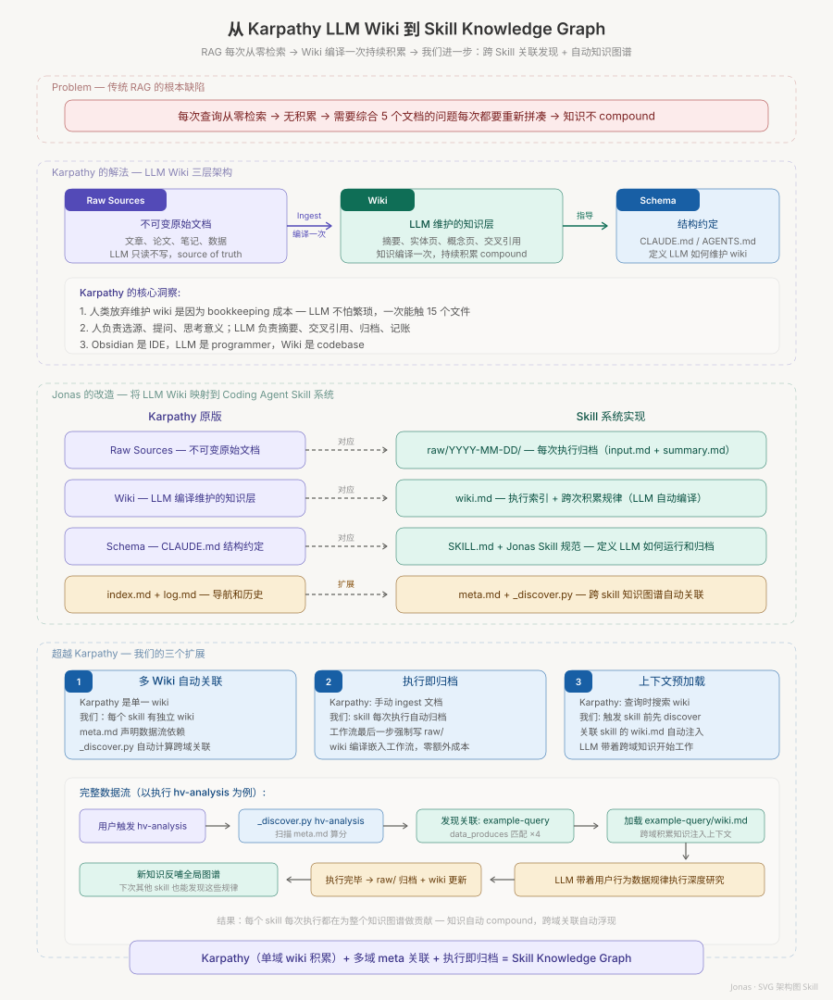

# skill-creator

*[English](README.md)*

**一个让 agent skill 每跑一次就变强一点的工作台。**

多数 agent 的用法是把每次执行当一次性消耗品：agent 干活，你纠正它，纠正留在一份没人再读的聊天记录里，三周后你再纠正同一件事。这个仓库是我给这件事的答案——四层循环：原始执行轨迹被归档，蒸馏进一份持续维护的知识库，再编译回可执行的 skill，任何改动上线前先过评测门控。

这套机制在本仓库里从 `2026-06-08` 起就在跑，`git log --reverse` 就是凭证。2026 年 8 月，Google Research 发布了 [WikiSkill](https://arxiv.org/abs/2608.27454)，把非常接近的一套分层形式化了。下面的[对照章节](#与-wikiskillgoogle-research2026的关系)逐层比对了两者，也点出唯一一处实质差异。

---

## 它解决什么问题

三种失效模式，都是我在做这套东西之前踩过的：

1. **教训会蒸发。** 一次执行发现了不显然的东西——某个接口的怪脾气、一个真正管用的阈值、一句让模型不再打太极的措辞。没有地方放，这个发现就随会话一起死掉。
2. **指令只会向上堆。** 每条教训都往 skill 文件后面追加，最后变成 900 行结疤组织，模型反而不读真正重要的那几段。
3. **改完不知道有没有变好。** 你重写了一版，感觉更好，但没有证据。下一次重写又把上一次推翻。

分四层，是为了把只有一个文件时必然被搅在一起的几件事拆开。

---

## 四层结构

```
skill-name/
├── raw/                    # 第 1 层 —— 只追加的执行归档
│   └── YYYY-MM-DD_主题/
│       ├── input.md        #   这次被要求做什么
│       ├── summary.md      #   这次的 3–5 条发现
│       └── <产物>          #   产出文件的副本
├── wiki.md                 # 第 2 层 —— 蒸馏后的知识，由模型维护，禁止手改
├── SKILL.md                # 第 3 层 —— agent 实际加载的可执行 skill
└── <workspace>/            # 第 4 层 —— 评测运行、benchmark、A/B 对比
    └── iteration-N/
        └── eval-<名称>/
            ├── with_skill/ | old_skill/
            └── without_skill/
```

| 层 | 写入策略 | 谁维护 | 为什么必须单独一层 |
|---|---|---|---|
| `raw/` | 只追加，不修改 | 执行本身 | 证据必须不可变，否则回归无从追溯 |
| `wiki.md` | 认识变了就重写 | 模型，跨多次执行 | 知识需要被「合并」，也就是覆盖——和证据的策略正好相反 |
| `SKILL.md` | 谨慎编辑，控制在 500 行内 | 我拍板，模型起草 | 可执行层是预算，不是垃圾场 |
| 评测门控 | 每轮迭代一份，可丢弃 | 子 Agent + 一个人读 diff | 没有对照的改动只是猜测 |

加载顺序和分层同样重要：`SKILL.md` 的元数据常驻上下文（约 100 词），正文在触发时加载，捆绑资源只在流程走到时才读。`raw/` 从不进上下文——它的用途是让模型在编译 wiki 时去查，而不是随身背着。

---

## 与 WikiSkill（Google Research，2026）的关系



这张图画于 2026-06-08，是这套四层结构最初的设计来源——把 Karpathy 关于 LLM wiki 的构想映射到 coding agent 的 skill 系统上。

[WikiSkill: Compiling Agent Experience into Persistent Knowledge for Skill Evolution](https://arxiv.org/abs/2608.27454)（Tang、Rashtchian、Ferng、Tomkins、Juan、Vu，Google Research，2026 年 8 月）的核心主张是：把原始经验、累积知识、可执行 skill 三者分开，skill 演化的效果更好；而那份持续维护的 wiki 是出力最多的部件——他们的消融实验显示，去掉它效果就掉。

这和本仓库押的是同一个注，只是我从实践方向独立走到这里：我想解决的是别再重复教同一件事，不是刷 benchmark。

| WikiSkill | 本仓库 | 对应关系 |
|---|---|---|
| 原始执行经验 | `raw/YYYY-MM-DD_主题/` 归档 | 直接对应 |
| 持续知识库（wiki） | `wiki.md`，模型维护，跨次索引 + 累积观察 | 直接对应 |
| 可执行 skill | `SKILL.md` + `scripts/` + `references/` | 直接对应 |
| 持续把经验合并进 wiki | 归档是每个 skill 工作流的强制最后一步 | 直接对应 |
| 由验证集分数决定 skill 是否更新 | 由评测断言**加上我的判断**决定 | **不同** |

**必须说清的差异：** WikiSkill 把环闭上了——验证集分数自动决定更新后的 skill 是否取代现役版本。我的门控里坐着一个人。这不是因为自动化没必要，而是因为我单个 skill 的样本量是个位数、也没有带标准答案的验证集，自动分数只会是伪装成证据的噪声。所以这里跑的是自进化的前半段，后半段刻意留在手动，等数据足够支撑再闭。

另一处差异也值得点明：论文优化的是有可判定答案的 benchmark 任务；我的 skill 大多产出文档、表格、图，「对不对」有一部分是品味。所以这里的评测只量客观项（结构、公式错误、模板保真、触发准确率），其余交给并排对比的查看器让人读，而不是假装打分器能给散文打分。

---

## 循环怎么跑

1. **捕获意图。** 通常工作流已经在对话里发生过了——把用过的工具、步骤顺序、用户纠正过的每一处提取出来，然后确认缺口，而不是自己编。
2. **按固定规范起草 skill：** frontmatter 里写中英双语触发词，并明确区分「直接执行」和「先确认」；正文第一节是目录文件索引表；归档步骤写进工作流的最后一步。
3. **并行跑评测。** 每个测试用例同时起两个子 Agent，一个带 skill、一个不带（或对照上一版的快照），同一 turn 内启动，让它们同时结束。断言在运行期间起草。
4. **评分、聚合、把 diff 摊开看。** 客观断言由 grader 子 Agent 打分；再过一遍分析师视角，找聚合统计掩盖掉的模式。
5. **从反馈里泛化，而不是打补丁。** skill 文件里出现 `ALWAYS`、`NEVER` 一律当黄旗看——它通常意味着没把理由讲清楚。
6. **归档并编译。** `raw/` 收这次的输入和发现，`wiki.md` 重写以吸收它们。这一步是强制的，不是加分项——它才是让下一次执行起点更高的原因。
7. **最后优化 description。** description 是决定 skill 会不会被触发的唯一开关：20 条该触发/不该触发的查询，然后针对生产环境同一个模型跑优化循环。

## 快速开始

```bash
# 对某个 skill 做结构体检
python -m scripts.quick_validate <path/to/skill>

# 看相关 skill 之间的主题重叠
python3 scripts/discover.py <skill-name>

# 把一轮迭代聚合成 benchmark
python -m scripts.aggregate_benchmark <workspace>/iteration-1 --skill-name <name>

# 打开这轮迭代的评审查看器
python eval-viewer/generate_review.py <workspace>/iteration-1 \
  --skill-name <name> --benchmark <workspace>/iteration-1/benchmark.json
```

需要 Python 3.10+；description 优化循环需要 `claude` CLI。并行评测需要子 Agent，没有子 Agent 时会降级为顺序执行、不带 baseline。

## 目录结构

```
skill-creator/
├── SKILL.md                      # 整个体系里所有 skill 都要遵守的规范
├── meta.md                       # 主题与数据声明，供跨 skill 关联发现
├── wiki.md                       # 历次 skill 构建积累下来的教训
├── agents/
│   ├── grader.md                 # 按断言给运行结果打分
│   ├── comparator.md             # 两个版本之间的盲测 A/B
│   └── analyzer.md               # 解释某一版**为什么**赢
├── scripts/
│   ├── quick_validate.py         # 结构体检
│   ├── run_eval.py               # 单次评测
│   ├── aggregate_benchmark.py    # 迭代目录 → benchmark.json
│   ├── generate_report.py        # benchmark → 报告
│   ├── improve_description.py    # 触发准确率优化
│   ├── run_loop.py               # description 优化循环
│   ├── discover.py               # 跨 skill 主题重叠图
│   └── package_skill.py          # 打包 skill 用于分发
├── references/schemas.md         # evals.json / grading.json 的结构约定
└── eval-viewer/                  # 本地 HTML 评审界面
```

## 设计取舍

**为什么 wiki 由模型维护、禁止手改。** 我一手改，它就从 agent 的记忆变成我的笔记，模型也不再把它当可信来源。合并是模型的活，我的活是门控。

**为什么 `raw/` 只追加。** 它是唯一能证明「这次改动带来了回归」的一层。如果执行记录可以被改写，审计链就只是装饰。

**为什么每个 skill 都要在 `meta.md` 里声明主题。** 共享主题的 skill 往往需要一起改；关联发现脚本把这些对子显式列出来，改一个时会提醒去看另一个，而不是让两者悄悄漂移。

**如果重做我会改什么。** 门控是真正有意思的边界：给每个 skill 攒够带标注的用例，让分数能拍板——至少对产出客观可判定的那批 skill 先做到。这一步才是把「辅助演化」变成「自动演化」的分水岭。

## 给现有 skill 加归档

给一个已经存在的 skill 补归档，最小可行配置是两步：建一个 `raw/` 目录、建一个空的 `wiki.md`；
然后在该 skill 的 `SKILL.md` 末尾加一节收尾步骤，写明先建当日归档目录并写入两份说明——`input.md`
记这次被要求做什么，`summary.md` 记 3-5 条发现——再读取 `wiki.md` 更新索引与跨次积累。

要顺带接进跨 skill 关联发现，再补一个 `meta.md`，声明这个 skill 的主题、产品范围、产出与消费的数据。
主题里写具体的词：「报告」「文档」这类泛词会把重叠分数抬虚，把不相关的 skill 也拉进上下文。配好后跑一次
关联发现看结果，再跑验收脚本——退出码为零才算过，这是判卷标准而不是建议。

## 致谢

四层分离的思路受 Andrej Karpathy 关于 agent 应当累积持久知识、而不是每次会话冷启动的公开讨论影响，也与 [WikiSkill](https://arxiv.org/abs/2608.27454)（Google Research，2026）收敛到同一套分层——后者从研究侧给出了这套分层的实证依据。

## 许可

MIT
